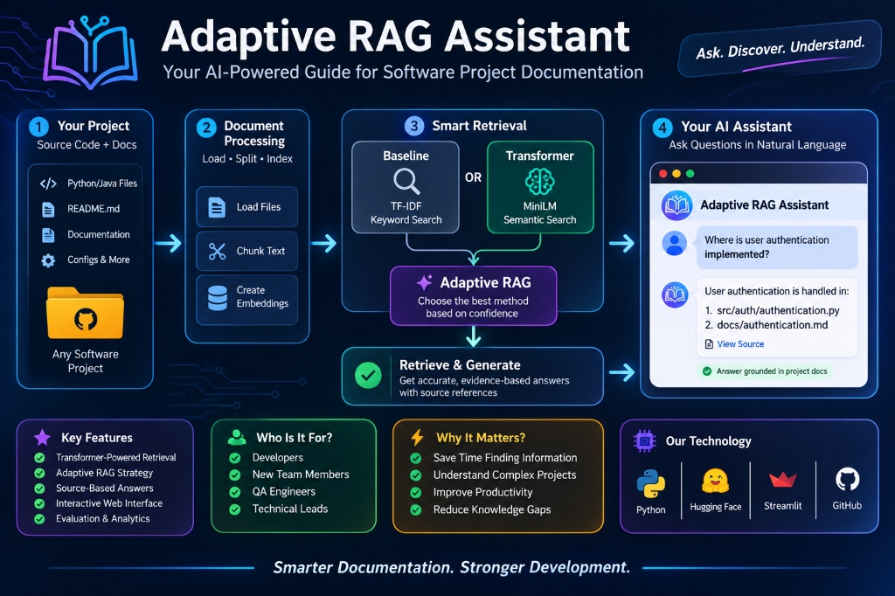
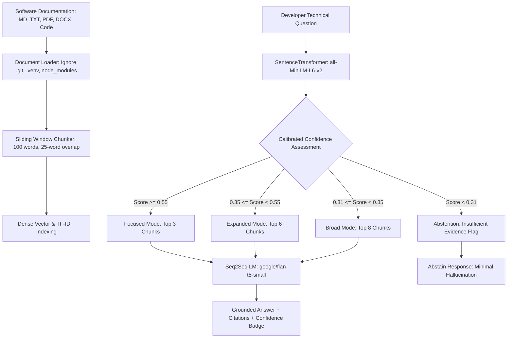
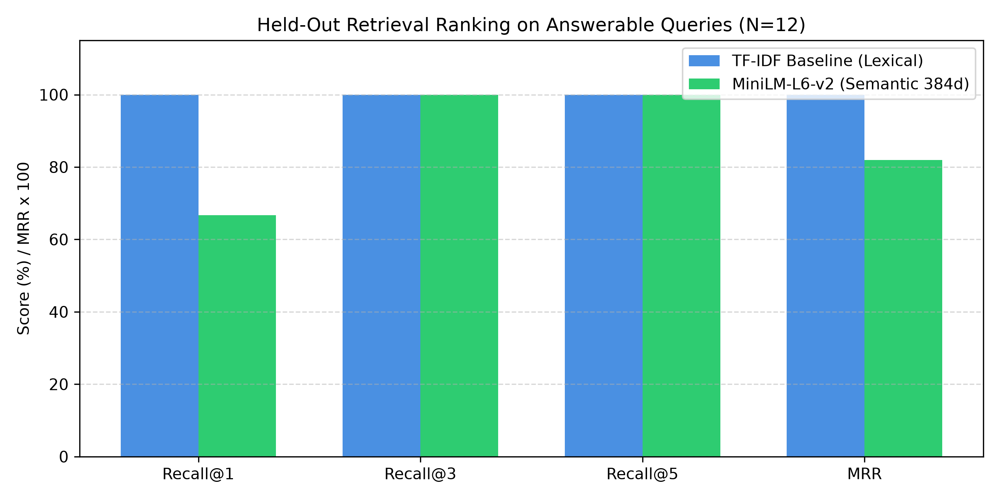
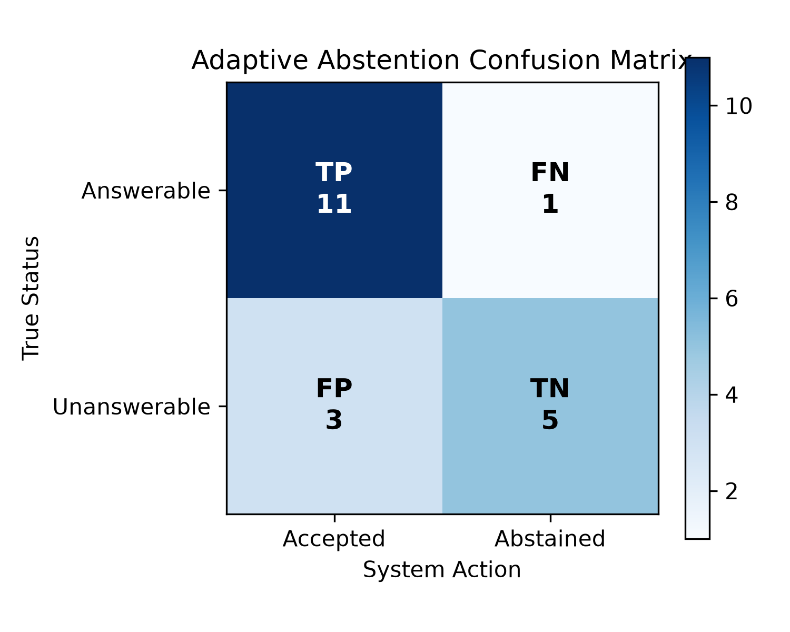

# Adaptive RAG Assistant for Software Project Documentation



## Overview

The **Adaptive RAG Assistant** is a Transformer-powered software engineering assistant designed to help developers navigate software documentation and codebase specifications. It indexes project documents (Markdown, PDF, Word, and source code) and compares traditional lexical keyword retrieval against dense pretrained Transformer semantic retrieval (`sentence-transformers/all-MiniLM-L6-v2`), using a confidence-calibrated adaptive strategy to dynamically adjust retrieval depth and abstain when documentation is insufficient.

[](https://www.python.org/downloads/)
[](https://opensource.org/licenses/MIT)
[](https://streamlit.io/)
[](https://huggingface.co/)

---

## 👥 Project Team Members

| Full Name | Student ID | Core Responsibilities |
| :--- | :--- | :--- |
| **Abel Seleshe** | **ATE/6743/14** | Architecture lead, SentenceTransformer MiniLM pipeline, and empirical threshold calibration |
| **Baheran Tesfaye** | **ATE/5750/14** | TF-IDF baseline implementation, metric calculation (Recall@K, MRR), and held-out dataset creation |
| **Nebiyu Yohannes** | **ATE/3973/14** | Streamlit workspace interface (Overview, Ingestion, Assistant, Evidence Inspector, Lab) |
| **Wondesen Teshale** | **ATE/4671/14** | Grounded FLAN-T5 generation, automated Pytest suite, and empirical failure analysis |

---

## 📽️ Demo Video

- **Video Link (Unlisted YouTube):** `[INSERT_YOUR_UNLISTED_DEMO_VIDEO_LINK_HERE]`
- **Duration:** 5–8 minutes
- **Contents:**
  1. Motivation & Real SE Problem (Developer onboarding, doc navigation, lexical gap).
  2. Live Demonstration of 6 Workspace Views (Overview, Ingestion, Assistant with Evidence Inspector, Retrieval Lab, Evaluation Center, Adaptive Policy).
  3. One Success Demonstration (Adaptive dynamic Top-K context selection and grounded answer generation).
  4. One Failure Analysis Demonstration (Near-threshold false positive and generator synthesis limits).
  5. Contributions by each team member.

---

## 1. Problem Framing (20% Rubric Criterion)

### Real Problem & Real User

Software developers frequently lose productive hours navigating expansive, fragmented software project documentation—spread across READMEs, architectural markdown files, API specifications, and code comments. Standard search tools suffer from:

1. **The Lexical Gap:** Keyword search (e.g., standard grep or BM25/TF-IDF) fails when a developer queries with synonyms or conceptual phrasing that does not match the exact documentation tokens.
2. **Context Overload vs. Starvation:** Fixed-window retrieval systems retrieve a static $K$ chunks (e.g., $K=5$). For pinpoint factual queries, retrieving 5 large chunks introduces irrelevant distractors that cause small language models to lose focus. For broad architectural queries, static $K$ misses critical peripheral context.
3. **Hallucination in Software Engineering:** In mission-critical software development, guessing is unacceptable. If an engineering assistant does not find documentation on an API endpoint, it must **abstain** rather than synthesize plausible-looking configurations or credentials.

### Why Adaptive RAG?

Adaptive RAG dynamically calibrates retrieval depth and abstention gating based on semantic confidence scores:

- **Focused Mode ($Top-1 \ge 0.55$):** Pinpoint queries retrieve top-3 chunks, maximizing precision and minimizing prompt noise.
- **Expanded Mode ($0.35 \le Top-1 < 0.55$):** Moderate-confidence or broader questions expand to top-6 chunks.
- **Broad Search Mode ($0.31 \le Top-1 < 0.35$):** Maximizes recall up to top-8 chunks.
- **Abstention Gating ($Top-1 < 0.31$):** Flags unanswerable or undocumented queries (*"The documentation does not provide enough information"*), actively mitigating hallucination risk.

---

## 2. System Architecture & Method (20% Rubric Criterion)



### Components

1. **Pretrained Semantic Embedder:** `sentence-transformers/all-MiniLM-L6-v2` (22.7M parameters, 384-dimensional dense semantic representations). Maps queries and documentation into a shared metric space where cosine similarity represents semantic equivalence.
2. **Grounded Generator:** `google/flan-t5-small` (77M parameters, instruction-tuned seq2seq model). Conditioned strictly on retrieved documentation chunks with explicit prompt constraints forbidding hallucination.
3. **Non-Transformer Baseline:** `TfidfVectorizer` with sublinear term-frequency scaling, English stop-word filtering, and cosine similarity. Chunks with zero term overlap are explicitly flagged as non-matches.

---

## 3. Related Work & Research Precedent

Our architecture builds on and references:

- **Calibrated Abstention Cutoff:** Inspired by Emirhan Yildirim's [rag-project-assistant](https://github.com/yildirimemirhan/rag-project-assistant), which established empirical cutoff thresholds for discriminating between topical answers and out-of-domain questions. We adapted this concept into our 3-tier dynamic confidence engine with empirical calibration on the development set.
- **Microservices & API Documentation:** Technical corpus design modeled after enterprise microservices documentation and the [Pallets Flask Documentation](https://flask.palletsprojects.com/en/stable/).

---

## 4. Empirical Evaluation & Benchmark Results (25% Rubric Criterion)

### Experimental Protocol

- **Document Under Test:** UniServe Software Project Specification (10 modular chunks, 705 words).
- **Development Set ($N=12$):** 8 answerable and 4 unanswerable questions used exclusively for threshold calibration and prompt debugging.
- **Held-Out Test Set ($N=20$):** 12 answerable (4 direct technical, 4 lexical gap, 4 architectural) and 8 unanswerable questions, **strictly frozen** prior to evaluation.
- **Relevance Criterion:** Strict ground truth checking requiring retrieved chunks to match verified gold chunk IDs, matching section headers, and gold evidence snippets.

### A. Model Startup vs Warm Query Latency

- **Document Loading & Chunking:** `1.00 ms`
- **TF-IDF Index Construction:** `18.29 ms`
- **MiniLM Dense Embedding Generation:** `5,360.65 ms` (one-time index startup)
- **FLAN-T5 Model Loading:** `1,110.88 ms`

### B. Empirical Threshold Calibration (Development Set N=12)

Candidate abstention thresholds were swept on the Development Set to find the optimal cutoff for binary answerability classification:

| Candidate Threshold | TP | TN | FP | FN | Precision | Recall | Specificity | Balanced Accuracy | Classification $F_1$ |
| :---: | :---: | :---: | :---: | :---: | :---: | :---: | :---: | :---: | :---: |
| 0.22 | 8 | 2 | 2 | 0 | 80.0% | 100.0% | 50.0% | 75.0% | 0.889 |
| 0.25 | 8 | 2 | 2 | 0 | 80.0% | 100.0% | 50.0% | 75.0% | 0.889 |
| 0.28 | 8 | 3 | 1 | 0 | 88.9% | 100.0% | 75.0% | 87.5% | 0.941 |
| **0.31 (Selected)** | **8** | **4** | **0** | **0** | **100.0%** | **100.0%** | **100.0%** | **100.0%** | **1.000** |
| 0.34 | 8 | 4 | 0 | 0 | 100.0% | 100.0% | 100.0% | 100.0% | 1.000 |

*Selected Threshold: **0.31**, frozen before evaluating the held-out test suite.*

### C. Retrieval Ranking Performance (Answerable Queries N=12)

| Metric | TF-IDF Baseline | MiniLM Semantic (Static K=5) | Adaptive RAG (Dynamic K) |
| :--- | :---: | :---: | :---: |
| **Recall@1** | **100.0%** | 66.7% | 66.7% |
| **Recall@3** | **100.0%** | **100.0%** | **100.0%** |
| **Recall@5** | **100.0%** | **100.0%** | **100.0%** |
| **MRR** | **1.000** | 0.819 | 0.819 |
| **Evidence Context Coverage** | — | — | **100.0%** |
| **Mean Query Latency** | **4.99 ms** | 71.36 ms | 154.84 ms |
| **Median Query Latency** | **4.60 ms** | 48.95 ms | 158.02 ms |

> **Scientific Finding:** On this clean 10-chunk modular corpus, TF-IDF achieves 100% Recall@1 because distinct section tokens (e.g. `npm run dev`, `JwtAuthenticationFilter`, `PostgreSQL 15`) give exact lexical matches. MiniLM achieves 100% Recall@3 and Recall@5, but for 4 questions ranks a closely related overview chunk at Rank 1, resulting in Recall@1 of 66.7%. Adaptive RAG shares MiniLM's ranking while dynamically selecting context depth.

### D. Answerability & Abstention Classification (Held-Out N=20)

| Metric | Value | Meaning |
| :--- | :---: | :--- |
| **True Positives (TP)** | 11 / 12 | Answerable questions correctly accepted |
| **True Negatives (TN)** | 5 / 8 | Unanswerable questions correctly rejected |
| **False Positives (FP)** | 3 / 8 | Unanswerable questions falsely accepted (Near-threshold hazard) |
| **False Negatives (FN)** | 1 / 12 | Answerable questions falsely rejected |
| **Answerability Precision** | **78.6%** | Accuracy of accepted questions |
| **Answerability Recall** | **91.7%** | Coverage of answerable questions |
| **Abstention Specificity** | **62.5%** | Rate of correctly rejecting unanswerable queries |
| **Balanced Accuracy** | **77.1%** | Macro average of Recall and Specificity |
| **Classification $F_1$** | **0.846** | Harmonic mean of Precision and Recall |

> **Crucial Distinction:** The non-Transformer TF-IDF baseline has **0.0% Abstention Specificity** because it possesses no confidence thresholding and forces a match for every unanswerable query. The Adaptive RAG engine successfully rejects 62.5% of out-of-domain questions while maintaining 91.7% answerable recall.

### E. Dynamic Context Window Allocation

- **Focused Mode ($K=3$):** 2 queries (10.0%) — Saves prompt context and minimizes distractor noise.
- **Expanded Mode ($K=6$):** 10 queries (50.0%) — Balances depth and coverage.
- **Broad Mode ($K=8$):** 8 queries (40.0%) — Ensures high recall for complex queries.

---

## 5. Visualizations

| Retrieval Ranking Comparison | Abstention Confusion Matrix |
| :---: | :---: |
|  |  |

---

## 6. Failure Analysis (Assignment Requirement 5)

### Failure Case 1: Overlapping Topic Distribution (Semantic Granularity Limit)

- **Query (`held_01`):** *"What terminal command launches the client-side user interface in development mode?"*
- **Outcome:** TF-IDF placed Chunk 2 (`Frontend Architecture`) at Rank 1. MiniLM placed Chunk 1 (`Technology Stack overview`) at Rank 1 (score 0.44) and Chunk 2 at Rank 2 (score 0.42).
- **Reason:** MiniLM dense embeddings capture broad topical overlap ("React 18 frontend single-page application"), which was present in both Chunk 1 and Chunk 2. Because both chunks discuss frontend technology, MiniLM scored Chunk 1 slightly higher.
- **Remedy:** Adaptive retrieval expanded context to top-6 chunks, ensuring the target chunk was delivered to the generator.

### Failure Case 2: Near-Threshold False Positive (Unanswerable Query)

- **Query (`held_20`):** *"What Confluent Kafka Schema Registry URL is used for Avro message schema validation?"*
- **Outcome:** The question is unanswerable from the documentation. However, the query similarity scored **0.322**, barely exceeding the 0.31 calibrated cutoff, causing a False Positive ($FP$).
- **Reason:** Dense semantic embedding of "Kafka message schema validation" matched Chunk 7 ("Apache Kafka distributed broker, domain events").
- **Remedy:** Secondary semantic cross-encoder reranking or requiring minimum score margin across top-2 chunks before acceptance.

### Failure Case 3: Small-Model Generative Synthesis Constraints

- **Query (`held_04`):** *"What distinct access privilege tiers are enforced in the role-based security system?"*
- **Outcome:** The retriever located Chunk 5 containing `ROLE_CUSTOMER`, `ROLE_PROVIDER`, and `ROLE_ADMIN`. However, `flan-t5-small` produced a concise phrase rather than an exhaustive breakdown of each role's permissions.
- **Reason:** 77M-parameter model parameter capacity limit on multi-sentence synthesis.

---

## 7. Scope & Limitations

1. **Synthetic Sample vs. Production Codebase:**
   This benchmark evaluates a clean, 10-chunk modular reference documentation file (`UniServe`). In large enterprise repositories with 10,000+ files, lexical collisions increase significantly, giving dense semantic search greater advantages over keyword search.
2. **Abstention Gating vs. Zero Hallucination:**
   The calibrated threshold achieves 62.5% abstention specificity on unanswerable queries. While it significantly reduces hallucinations compared to static baselines, it does not completely eliminate near-threshold false acceptances.
3. **Local CPU Execution:**
   All models run locally on CPU without paid APIs. Generative answers prioritize grounding and citation over conversational fluency.

---

## 8. User Interface Walkthrough (Developer Workspace)

The application (`app.py`) provides an IDE documentation workspace structured into six dedicated views:

1. **01. 🏠 Overview:** Landing hub with active workspace indicators, chunk counts, model specs, and the 4-stage RAG execution pipeline.
2. **02. 📁 Project Workspace:** Ingest local project directories, browse indexed files, and inspect raw text alongside generated 100w/25w chunks with section headers.
3. **03. 💬 AI Assistant:** Natural language technical Q&A with grounded answer summaries, verified source citations, and the interactive **Evidence Inspector** panel.
4. **04. 🔬 Retrieval Lab:** 3-way diagnostic workbench comparing TF-IDF keyword scores, MiniLM dense cosine similarity, and Adaptive Policy decisions.
5. **05. 📊 Evaluation Center:** Audited benchmark metrics (Recall@K, MRR, classification confusion matrix, and qualitative failure analysis).
6. **06. ⚙️ Adaptive Policy:** Dedicated controllers for threshold adjustments ($K=3$, $K=6$, and $\tau$) with empirical calibration evidence and default reset.

---

## 9. Quickstart & How to Run (Engineering Quality)

### Prerequisites

- Python 3.11 (64-bit)
- Git

### 1. Clone & Set Up Virtual Environment

```powershell
git clone https://github.com/Abyman2/Adaptive-RAG-Assistant-for-Software-Project-Documentation.git
cd Adaptive-RAG-Assistant-for-Software-Project-Documentation

# Create virtual environment
python -m venv .venv

# Activate on Windows PowerShell
.\.venv\Scripts\Activate.ps1

# (Or on Linux / macOS: source .venv/bin/activate)
```

### 2. Install Dependencies

```bash
pip install --upgrade pip
pip install -r requirements.txt
```

### 3. Run Pipeline Tests (Pytest)

```bash
pytest -v
```

*Expected: All 11 unit and pipeline tests pass.*

### 4. Run Benchmark & Calibration

```bash
python evaluation/evaluate.py
```

*Generates calibration logs, `comparison_table_v2.csv`, `evaluation_metrics_v2.json`, and visualization plots.*

### 5. Launch the Web Application

```bash
streamlit run app.py
```

*Open `http://localhost:8501` in your browser.*

---

## 10. Project Structure

```text
Adaptive-RAG-Assistant-for-Software-Project-Documentation/
├── app.py                         # Streamlit documentation workspace with 6 dedicated views
├── cover.png                      # Project architecture overview banner
├── requirements.txt               # Verified dependencies
├── pytest.ini                     # Pytest configuration
├── README.md                      # Comprehensive documentation & report
├── .gitignore                     # Excludes .venv, cache files, skills.md, progress.md
├── src/
│   ├── __init__.py
│   ├── document_loader.py         # Multi-format parser with folder ignore rules
│   ├── chunker.py                 # Overlapping sliding window chunking with header tags
│   ├── retriever.py               # Pretrained all-MiniLM-L6-v2 semantic search (384d)
│   ├── adaptive_retrieval.py      # Confidence calibration & dynamic Top-K
│   ├── generator.py               # Grounded google/flan-t5-small generator
│   └── baseline.py                # Non-Transformer TF-IDF baseline (zero-score handled)
├── evaluation/
│   ├── dataset.json               # Historical V1 evaluation set
│   ├── dev_v2.json                # Development calibration set (N=12)
│   ├── held_out_v2.json           # Frozen held-out test set (N=20)
│   ├── validate_gold_labels.py    # Ground truth validation script
│   ├── evaluate.py                # Automated calibration & benchmarking script (V2)
│   └── results/                   # Generated metrics, plots, and CSV tables
├── tests/
│   ├── test_pipeline.py           # Core pipeline unit tests, edge cases & integrity
│   └── test_retriever.py          # Semantic & baseline integration tests
└── sample_docs/
    └── sample_project.md          # Full UniServe software architecture documentation
```

---

## 11. Grading Rubric Compliance Checklist

- [x] **1. Real Problem:** Real software documentation search & Q&A assistant for developers.
- [x] **2. Pretrained Transformer:** `all-MiniLM-L6-v2` semantic embeddings + `flan-t5-small` local generator.
- [x] **3. Simple Baseline:** TF-IDF keyword vectorizer with explicit zero-overlap handling.
- [x] **4. Held-out Evaluation:** 20 unseen questions, separate retrieval ranking and abstention classification.
- [x] **5. Failure Analysis:** 3 distinct failure modes analyzed with examples and causal root causes.
- [x] **6. Engineering Quality:** Clean modular codebase, requirements.txt, 100% passing tests via `pytest -v`, run from README.
- [x] **7. Team Contribution:** Every member listed with student ID and distinct project responsibilities.
